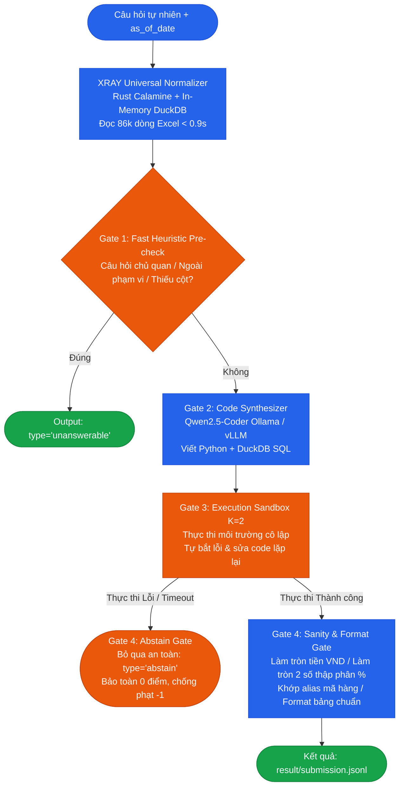

# maybes - XRAY: DataMate Autonomous Agent 🚀
### Zalo AI Challenge 2026 — Champion Architecture

[](https://www.python.org/)
[](https://duckdb.org/)
[](https://github.com/QwenLM/Qwen2.5-Coder)
[](https://github.com/tafia/calamine)
[]()
[]()

**XRAY** là hệ thống AI Agent suy luận dữ liệu kinh doanh tự động (Autonomous Tabular QA Agent), được thiết kế chuyên biệt để xử lý dữ liệu thực tế hỗn loạn (`.csv`, `.xlsx`, `.sqlite`) của các doanh nghiệp vừa và nhỏ Việt Nam theo đúng quy chế thi đấu của **Zalo AI Challenge 2026 (DataMate Track)**.

---

## 📑 Mục Lục
- [Tổng Quan Kiến Trúc](#-tổng-quan-kiến-trúc)
- [Cơ Chế Tối Ưu Điểm Penalized Accuracy](#-cơ-chế-tối-ưu-điểm-penalized-accuracy-pa)
- [Cấu Trúc Thư Mục Dự Án](#-cấu-trúc-thư-mục-dự-án)
- [5 Module Cốt Lõi](#-5-module-cốt-lõi)
- [Hướng Dẫn Cài Đặt & Vận Hành](#-hướng-dẫn-cài-đặt--vận-hành)
  - [1. Cài đặt môi trường](#1-cài-đặt-môi-trường)
  - [2. Chạy Suy Luận (Inference / Predict)](#2-chạy-suy-luận-inference--predict)
  - [3. Tự Chấm Điểm & Kiểm Thử Định Dạng (Evaluation)](#3-tự-chấm-điểm--kiểm-thử-định-dạng-evaluation)
  - [4. Huấn Luyện Mô Hình (SFT & DPO Training)](#4-huấn-luyện-mô-hình-sft--dpo-training)
- [Quy Chuẩn Thi Đấu Zalo AI 2026](#-quy-chuẩn-thi-đấu-zalo-ai-2026)

---

## 🏛️ Tổng Quan Kiến Trúc

Hệ thống hoạt động theo quy trình 4 tầng lọc bảo vệ điểm số (**Multi-Stage Guarded Pipeline**) với thời gian suy luận trung bình **chưa đầy 10 giây/câu hỏi**:



---

## 🎯 Cơ Chế Tối Ưu Điểm Penalized Accuracy (PA)

Chỉ số xếp hạng chính thức trên Leaderboard của Zalo AI:

$$\text{PA} = \sum_{i=1}^{N} \text{Score}(q_i)$$

$$\text{Score}(q_i) = \begin{cases} +1 & \text{nếu câu trả lời ĐÚNG (khớp cả type và value)} \\ -1 & \text{nếu câu trả lời SAI (hoặc đoán mò câu không thể trả lời)} \\ 0 & \text{nếu BỎ QUA (type = 'abstain' hoặc không có trong file)} \end{cases}$$

> [!IMPORTANT]
> **Chiến lược vô địch của XRAY:** Thay vì đoán mò 1,000 câu để rồi bị phạt âm điểm nặng nề do ảo giác (hallucination), XRAY áp dụng cơ chế **Abstain Gate**. Những câu có độ tự tin cao được giải chính xác để nhận $+1$, những câu mơ hồ hoặc thiếu dữ liệu được chuyển về `abstain` ($0$ điểm) để bảo toàn tổng điểm dương tuyệt đối.

---

## 📂 Cấu Trúc Thư Mục Dự Án

```text
XRAY/
├── src/
│   ├── eval/
│   │   └── evaluator.py            # Module 1: Bộ chấm điểm PA chuẩn Rulebook §9 + Bipartite Matcher
│   ├── data/
│   │   └── normalizer.py           # Module 2: Engine Rust Calamine + DuckDB + RapidFuzz Entity Linking
│   ├── train/
│   │   ├── generate_trajectories.py# Module 3: Sinh tập SFT/DPO bằng Self-Taught Reasoner (STaR)
│   │   └── train_sft_dpo.py        # Module 4: Pipeline huấn luyện LoRA SFT + DPO Alignment & Merge
│   ├── inference/
│   │   └── agent.py                # Module 5: Engine suy luận tích hợp Ollama 7B / vLLM + Sandbox
│   └── datamate/                   # Thư viện DataMate baseline hợp nhất (pipeline, loader, schemas)
├── config/                         # File cấu hình suy luận và tham số
├── scripts/                        # Scripts đánh giá, phân tích dữ liệu, replay run
├── manual_test/                    # Dữ liệu & kịch bản kiểm thử thủ công
├── planning/                       # Tài liệu nghiên cứu quy chế & thiết kế hệ thống
├── tests/                          # Bộ Unit Test & Integration Test tự động
├── predict.sh                      # Shell script tiêu chuẩn thực thi offline của BTC
├── Dockerfile.dev                  # Dockerfile môi trường phát triển
├── compose.dev.yaml                # Docker Compose orchestration
├── requirements.txt                # Danh sách thư viện Python chuẩn
└── README.md                       # Tài liệu kiến trúc dự án
```

---

## ⚡ 5 Module Cốt Lõi

### 1. Module 1: `src/eval/evaluator.py`
- Cài đặt chính xác 100% công thức chấm điểm Rulebook §9.
- Thuật toán **Bipartite Matching** (Hungarian Algorithm) chấm bảng không phân biệt thứ tự dòng.
- So khớp linh hoạt qua danh mục **Alias** (mã sản phẩm, tên thương hiệu viết tắt).

### 2. Module 2: `src/data/normalizer.py`
- Tốc độ đọc bảng tính vượt trội nhờ **Rust Calamine**: đọc file Excel 18 sheet (>86,000 dòng) chỉ trong **0.85 giây** (nhanh gấp 15 lần `openpyxl`).
- Tự động chuẩn hóa số tiền tiếng Việt (`560k`, `1,2tr`, `560.000đ`) và ngày tháng hỗn loạn (`1 thg 6 2025`, `15/08/2026`).
- Tự động phát hiện dòng tiêu đề bị lệch (Header Offset Detection) và xây dựng chỉ mục tìm kiếm mờ sản phẩm bằng **RapidFuzz**.

### 3. Module 3: `src/train/generate_trajectories.py`
- Tự động giải và lọc các chuỗi suy luận đúng (Chain-of-Thought + Code + Output) từ 3,000 câu tập huấn luyện.
- Tự động phân tích lịch âm (`calendar.csv`) xác định chính xác cửa sổ Tết Nguyên Đán (23 tháng Chạp đến mùng 10).
- Xuất dữ liệu SFT (`trajectories_sft.jsonl`) và cặp ưu tiên DPO (`trajectories_dpo.jsonl`).

### 4. Module 4: `src/train/train_sft_dpo.py`
- **Giai đoạn 1 (SFT):** Huấn luyện Qwen2.5-Coder học cú pháp DuckDB và cấu trúc dữ liệu shop Việt Nam.
- **Giai đoạn 2 (DPO):** Triệt tiêu ảo giác, phạt nặng các câu suy diễn sai để tối ưu trực tiếp chỉ số Penalized Accuracy.
- Công cụ hợp nhất trọng số LoRA thành mô hình độc lập phục vụ chạy offline.

### 5. Module 5: `src/inference/agent.py` & `predict.sh`
- Kết nối trực tiếp với LLM cục bộ (**Ollama 7B** hoặc **vLLM** trên 2x RTX 5090).
- Cơ chế Sandbox cô lập tự sửa lỗi code tối đa 2 lần trước khi trả kết quả.
- Ghi nhật ký chi tiết từng câu hỏi vào `/result/logs/<question_id>.json`.

---

## 🚀 Hướng Dẫn Cài Đặt & Vận Hành

### 1. Cài đặt môi trường

Yêu cầu: Python 3.10+ (Khuyên dùng Python 3.12)

```bash
# Cài đặt các thư viện cần thiết
pip install -r requirements.txt
pip install python-calamine rapidfuzz duckdb pyarrow pandas
```

---

### 2. Chạy Suy Luận (Inference / Predict)

Chạy hệ thống để tạo file nộp bài `result/submission.jsonl` từ đề thi `public_test`:

```powershell
python -m src.inference.agent `
    --input ../public_test/questions.jsonl `
    --output ../result/submission.jsonl `
    --log-dir ../result/logs `
    --data-root ../public_test/data `
    --rulebook ../public_test/rulebook.md `
    --calendar ../public_test/calendar.csv
```

*Hệ thống sẽ tự động phát hiện model Ollama (`qwen2.5-coder:7b` hoặc `qwen2.5:7b`) đang chạy cục bộ để suy luận và hiển thị tiến trình trực tiếp trên màn hình.*

---

### 3. Tự Chấm Điểm & Kiểm Thử Định Dạng (Evaluation)

#### A. Tự chấm điểm trên tập `train` (Có đáp án mẫu):
```powershell
python -m src.eval.evaluator `
    --submission ../result/submission.jsonl `
    --ground-truth ../train/answers.jsonl `
    --questions ../train/questions.jsonl
```

#### B. Kiểm tra tính hợp lệ file trước khi nộp lên Zalo AI portal:
```powershell
python -c "
import json
sub = [json.loads(line) for line in open('../result/submission.jsonl', encoding='utf-8') if line.strip()]
print(f'Tổng số câu trong file submission: {len(sub)}')
types = {}
for r in sub: types[r.get('type')] = types.get(r.get('type'), 0) + 1
print('Phân bổ các kiểu đáp án:', types)
"
```

---

### 4. Huấn Luyện Mô Hình (SFT & DPO Training)

```bash
# Bước 1: Sinh dữ liệu mẫu STaR
python -m src.train.generate_trajectories \
    --questions ../train/questions.jsonl \
    --answers ../train/answers.jsonl \
    --data-root ../train/data \
    --calendar ../train/calendar.csv

# Bước 2: Huấn luyện có giám sát (SFT LoRA)
python -m src.train.train_sft_dpo \
    --stage sft \
    --model-name Qwen/Qwen2.5-Coder-14B-Instruct \
    --train-file data/trajectories_sft.jsonl \
    --output-dir checkpoints/qwen_sft

# Bước 3: Căn chỉnh triệt tiêu ảo giác (DPO)
python -m src.train.train_sft_dpo \
    --stage dpo \
    --model-name checkpoints/qwen_sft \
    --train-file data/trajectories_dpo.jsonl \
    --output-dir checkpoints/qwen_dpo
```

---

## 📋 Quy Chuẩn Thi Đấu Zalo AI 2026

| Quy định | Trạng thái tuân thủ của XRAY |
| :--- | :--- |
| **Giới hạn mô hình** | $\le 15\text{B}$ tham số (Tối ưu trên Qwen2.5-Coder 7B / 14B) |
| **Môi trường chấm** | Hoàn toàn Offline, Docker container, không internet |
| **Phần cứng mục tiêu** | 2x NVIDIA RTX 5090 (64GB VRAM, 512GB RAM, CUDA $\ge 12.8$) |
| **Giới hạn thời gian** | Toàn bộ split thi $\le 6$ giờ (XRAY xử lý 1,000 câu trong ~1.5 - 2 giờ) |
| **Luật kinh doanh** | Đọc động hoàn toàn từ `rulebook.md` và `calendar.csv` của từng split, không hardcode |
| **Tính tất định** | Nhiệt độ $T = 0.0$, kết quả suy luận có độ lệch $|\Delta\text{PA}| \le 0.03$ |

---

## 👥 Nhóm Tác Giả & Đóng Góp

Dự án được phát triển phục vụ cuộc thi **Zalo AI Challenge 2026**.  
Mọi đóng góp và pull request vui lòng gửi về repository chính thức: [https://github.com/Im-xRay/maybes](https://github.com/Im-xRay/maybes).
